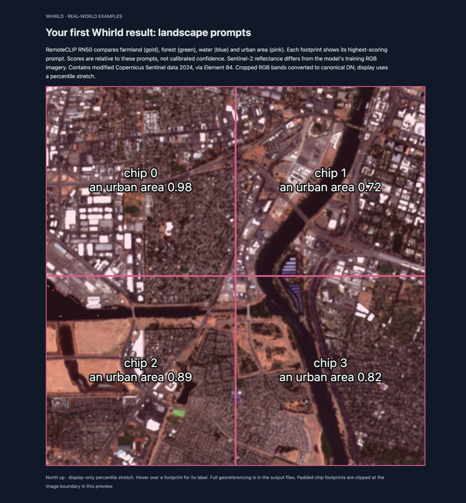

# Whirld

**Run geospatial foundation models locally, with georeferenced results.**

Whirld handles band selection, resampling, normalization and image chips for
embedding, text-prompt classification and segmentation. Start with a real model
and a small included Sentinel-2 image; open the result in your browser or GIS.

## Quickstart — unreleased preview

The `doctor` and `demo` commands below are new. **The published 0.3.0 wheel does
not include them.** This preview installs a pinned source archive without Git, a
repository checkout or development tools. PyPI publication is a separate step.

Install [uv](https://docs.astral.sh/uv/getting-started/installation/) once, then run
these commands in a new directory on macOS or Linux. uv provisions Python 3.13.7
if needed. The starter profile installs the RemoteCLIP runtime with CPU PyTorch.

```bash
uv venv --python 3.13.7 .venv
uv pip install --python .venv/bin/python --torch-backend cpu \
  -r https://raw.githubusercontent.com/cercanasystems/whirld/6b70aa931f4dc03bd4abf2e6345c224f4643b277/requirements-quickstart.txt \
  'whirld[remoteclip] @ https://github.com/cercanasystems/whirld/archive/6b70aa931f4dc03bd4abf2e6345c224f4643b277.zip'
.venv/bin/whirld doctor
.venv/bin/whirld demo --output quickstart-results
```

Open **`quickstart-results/preview.html`** in your browser. No map server, imagery
account, GPU or system GDAL installation is needed for this tested starter path.
The first demo downloads **408.4 MB** of RN50 weights; later runs reuse the
verified model cache. Python/runtime installation downloads are additional. Plan
for at least 4 GB RAM and sufficient free disk space. Doctor checks setup first
and gives repair commands for the active environment.



The preview shows which of four landscape prompts scores highest for each image
chip. These are prompt-relative model scores, not calibrated land-cover confidence
or ground truth. The included crop is predominantly urban; all four chips select
the urban prompt in the recorded run.

The result directory also contains `scores.geojson` for QGIS, the exact sample
TIFF and `report.json` with model/sample identities and runtime details. Choose a
new output directory for another run; existing results are preserved. The sample
contains modified Copernicus Sentinel data 2024, via Element 84.

See the [quickstart guide](docs/quickstart.md) for pip installation, troubleshooting,
recorded setup times, data attribution and the next step with your own imagery.
The [three larger examples](examples/README.md) cover similarity, classification
and burn-scar mapping after the first result.

---

## Status: 0.3.0 published

[Whirld 0.3.0](https://github.com/cercanasystems/whirld/releases/tag/v0.3.0)
includes Prithvi flood support, bounded-memory segmentation, and RemoteCLIP
RN50/ViT-L/14 variants. Published wheel/source assets and checksums are verified.
See [flood support](docs/flood-model.md),
[segmentation streaming](docs/segmentation-streaming.md), and
[model variants](docs/model-variants.md).

The current checkout additionally supports [local GeoTIFF streaming](docs/local-streaming.md)
for all three workflows. This is unreleased and is not part of the 0.3.0 artifacts.
The [labeled evaluation suite](docs/evaluation.md) adds a small, hash-pinned HLS
burn-scar quality baseline with separate validation/test metrics; it is also unreleased.

This repository implements the Whirld MVP (see
[`whirld-prd-mvp.md`](whirld-prd-mvp.md)): **three model paradigms** (embed / classify /
segment) across seven bundled models, a CLI, a REST API, local-file, **STAC and direct remote COG** input,
and a contributor-facing registry with a security + license **governance gate**. The
offline `clay-v1` reference model runs with **no network**; the trained models
download + sha256-verify genuine checkpoints and run the real networks.

### What is real and tested here

- **Band-contract translation** (Whirld's core contribution): alias-based band
  selection, resampling, scale + per-band z-score normalization, chipping with
  edge padding, and georeferenced chip bounding boxes.
- **Sensor detection** with the full precedence chain (`--sensor` override → TIFF
  tags → band descriptions → resolution).
- **Three paradigms behind one pipeline**: `embed` (vectors), `classify` (zero-shot
  text query → GeoJSON scores), `segment` (per-pixel mask GeoTIFF).
- **Input**: local GeoTIFF/COG, **a STAC item URL or a direct remote COG URL** — band assets read with COG
  `/vsicurl/` range requests, optional `--bbox` window, bearer-token auth.
- **Registry**: bundled, schema-validated model YAMLs seeded into `~/.whirld`, with
  registry-driven backend selection and a **governance gate** (license + weights-RCE
  policy; see [Registry governance](#registry-governance-security--license)).
- **`pull` contract**: resolve → acquire → **sha256 verify** → `manifest.json`,
  with the documented exit codes.
- **CLI** (`pull`, `list`, `info`, `embed`, `classify`, `segment`, `serve`, `rm`),
  **public Python API**, structured logging, and a local `usage.jsonl` record.
- **REST API** (`whirld serve`): `GET /health`, `GET /models`, `POST /embed`
  (multipart upload → `.npz` bundle with metadata, raw `.npy`, or JSON), `POST /classify`
  (multipart upload + `query` → GeoJSON), and `POST /segment` (→ `image/tiff` mask),
  with models warm-loaded and kept resident.
- **Real model weights**: `clay-v1.5` (1024-dim embeddings, `hf` extra), `remoteclip`
  (zero-shot classification, `remoteclip` extra), and `prithvi-burn-scar` (segmentation,
  `prithvi` extra) all download + sha256-verify genuine checkpoints and run the real
  models.
- **Clean-room install test** on fresh Linux x86 (Docker) — base deps only, no system
  GDAL, validated end to end — plus a parallel macOS ARM (Tart VM) harness.
- Unit + integration tests enforce **at least 80% coverage**, with opt-in checks
  against real model weights and public COGs. Current results are recorded in
  [development progress](dev_progress.md).

### Models

| Model | Paradigm | Backend | Network | Output |
|---|---|---|---|---|
| `clay-v1.5` | embeddings | **real Clay encoder** (torch) | 5.16 GB | 1024-dim `.npy` |
| `remoteclip` | classification | **real RemoteCLIP** (open_clip) | 605 MB | GeoJSON scores |
| `prithvi-burn-scar` | segmentation | **real Prithvi** (TerraTorch) | 1.30 GB | mask GeoTIFF |
| `prithvi-flood` | segmentation | **real Prithvi TL** (TerraTorch) | 1.28 GB | mask GeoTIFF |
| `remoteclip-rn50` | classification | **real RemoteCLIP RN50** | 408 MB | GeoJSON scores |
| `remoteclip-vit-l14` | classification | **real RemoteCLIP ViT-L/14** | 1.71 GB | GeoJSON scores |
| `clay-v1` | embeddings | deterministic reference (numpy) | none | 512-dim `.npy` |

All sit behind the same `ModelBackend` interface, so the translation pipeline,
CLI, REST API, and output code are identical regardless of which one runs. The
offline `clay-v1` reference is kept for no-network / fast-test / no-GPU use.

**Fidelity caveats (documented, not silently shipped):**
- `clay-v1.5`: fully metadata-conditioned — per-chip `lat/lon` (reprojected from the
  raster) and scene `time` (from `--datetime` or `TIFFTAG_DATETIME`) are fed to the
  encoder using Clay's exact formulas. When the acquisition datetime is unknown,
  `time` falls back to zeros (Clay's neutral value); lat/lon is always derived.
- `remoteclip`: scores are `logit_scale`-scaled softmax **probabilities** (0–1) —
  multiple `--query` values give true zero-shot multi-class; a single query is
  softmaxed against a neutral `background` prompt. S2-DN→8-bit RGB tone mapping is
  approximate (the model was trained on 8-bit RGB), so absolute scores on
  Sentinel-2 are approximate.

The real Clay encoder is vendored (Apache-2.0, attributed) under
[`models/_vendor/clay_v15/`](src/whirld/models/_vendor/clay_v15/) — see its
`PROVENANCE.md`. (Clay's own `claymodel` package can't be pip-installed on Python
3.13, so the minimal encoder is vendored. RemoteCLIP needs no vendoring —
`open_clip_torch` installs cleanly; its weights come from the public
`chendelong/RemoteCLIP` mirror since `BAAI/RemoteCLIP` is gated.)

**`prithvi-burn-scar` caveats:** single-image binary segmentation (the PRD's
before/after temporal stacking does not match the published heads); the two task
heads are separate checkpoints, so Whirld exposes `prithvi-burn-scar` /
`prithvi-flood` (with its distinct L1C input contract), with `prithvi-eo-2 --head <h>` accepted
as an alias. Needs the `prithvi` extra (`pip install 'whirld[prithvi]'`).

### Deferred (extension points left in place)

STAC input over the **REST** bodies (the CLI/library STAC path
is implemented) and STAC multi-item *search*, remote registry sync (`update`), and
quantized variants.

---

## Install 0.3.0

Download the wheel, source archive and `SHA256SUMS` from the
[0.3.0 release](https://github.com/cercanasystems/whirld/releases/tag/v0.3.0).
Verify checksums before installing; see the [release guide](docs/releases.md).
With Python 3.13.7 and the downloaded wheel in the current directory:

```bash
python3.13 -m venv .venv
.venv/bin/python -m pip install ./whirld-0.3.0-py3-none-any.whl
.venv/bin/whirld --help
.venv/bin/whirld pull clay-v1
```

Install optional model/server runtimes from the wheel, for example
`.venv/bin/python -m pip install './whirld-0.3.0-py3-none-any.whl[remoteclip]'`.
Other extras are `hf`, `prithvi` and `serve`; model weights download separately.
The examples use the pinned development environment below. PyPI publication is
separate. See [release notes](CHANGELOG.md) for compatibility and verification.

## Install (development)

Requires Python 3.13.7 or newer. Release verification uses Python 3.13.7 on
macOS ARM64 and Ubuntu 24.04 x86-64 CI; newer interpreters and other platforms
have not been verified.

```bash
python3.13 -m venv .venv
.venv/bin/python -m pip install -e . -r requirements-dev.txt
```

## Usage

### CLI

```bash
whirld pull clay-v1            # offline reference model (fast, no network)
whirld pull clay-v1.5          # real Clay v1.5 weights (5.16 GB; needs whirld[hf])
whirld pull remoteclip         # real RemoteCLIP (605 MB; needs whirld[remoteclip])
whirld list                    # installed models
whirld info clay-v1.5          # band contract, sensors, license, citation
whirld embed --model clay-v1.5 --datetime 2024-06-01T10:00:00Z scene.tif   # real 1024-dim embeddings
whirld classify --model remoteclip --query "solar farm" scene.tif          # GeoJSON scores
whirld segment --model prithvi-burn-scar hls_scene.tif                     # mask GeoTIFF
whirld embed --model clay-v1 https://earth-search.aws.element84.com/.../item.json \
  --bbox -1.30,52.50,-1.27,52.52                                           # STAC item (range reads)
whirld rm clay-v1              # remove a cached model (rm --all clears everything)
```

**Input** is a local GeoTIFF/COG, **a STAC item URL or a direct remote COG URL**. For a STAC item, Whirld
fetches the item JSON, picks only the band assets the model needs, and reads them with
COG **range requests** (`/vsicurl/`). Pass `--bbox MIN_LON,MIN_LAT,MAX_LON,MAX_LAT`
(EPSG:4326) to window the read, `--sensor` if it can't be inferred from the item, and
`--stac-token` (or `WHIRLD_STAC_TOKEN`) for gated endpoints. Works on
`embed`/`classify`/`segment`; the item path needs no extra dependency.

For direct HTTP(S) `.tif`/`.tiff` inputs, always supply `--sensor` and complete
TIFF band descriptions or explicit `--bands` names in source order. Use `--cog`
for extensionless endpoints and `--scale 1` for already-scaled reflectance. See
[direct COG input](docs/direct-cog.md) for metadata precedence, Python `CogOptions`,
streaming usage and a tested public sample.

Bearer credentials are scoped to the original item's HTTP origin (scheme, host,
and port). Cross-origin item redirects lose authorization, and asset redirects
never forward it. Direct assets on another origin receive no token unless that
origin is explicitly supplied to `read_stac_item(token_origins=(... ,))` or
`embed_to_disk(token_origins=(... ,))`.
Authenticated asset reads require GDAL >=3.10; older builds fail with an error.

Inputs must use a north-up projected grid in meters. Reproject geographic,
feet-based, rotated, or south-up rasters before inference. Both pixel dimensions
are respected when resampling. Named inputs must include every required band
unambiguously; positional band order applies only to entirely unlabeled rasters
with at least the required band count. Local files and uploads preserve nodata and
internal masks through resampling and normalization. Uploads accept GeoTIFF only.

Acquisition timestamps accept ISO-8601 (including STAC) and TIFF date tags;
timezone offsets normalize to UTC, and timestamps without a timezone mean UTC.
Classification GeoJSON uses WGS84 longitude/latitude and retains provenance in
`source_crs`. Segmentation masks use 255 for invalid pixels; class 0 remains valid.
Default embedding and segmentation outputs from HTTP(S) inputs use a sanitized
basename in the current directory, excluding URL credentials and query strings.
Local inputs, including `file://` URLs, retain adjacent output defaults.

**STAC radiometry:** the reader retains per-band scale, offset, and nodata from
`raster:bands` (Raster extension v1), or `bands` with `raster:scale` /
`raster:offset` (Raster extension v2). For multiband assets, named bands select
both the pixel plane and its corresponding metadata. In the v2 form, band fields
override asset-level defaults. Mixed v1/v2 band metadata is rejected as ambiguous.

When either scale or offset is declared, Whirld computes
`reflectance = stored_value * scale + offset` (missing scale defaults to 1,
missing offset to 0). It then converts reflectance to the model's canonical DN
using the sensor's `canonical_reflectance_scale`, before applying the existing
normalization. For example, a stored Sentinel-2 value of 3000 with scale 0.0001
and offset -0.1 becomes reflectance 0.2: real Clay receives canonical DN 2000
before its z-score, while the other bundled models normalize reflectance 0.2.
Offsets are taken from asset metadata, not inferred from processing-baseline or
item-level flags; already-corrected assets with offset 0 are not corrected again.

The bundled sensor contracts declare a canonical scale of 0.0001. Older cached
entries for Sentinel-2, Landsat 8/9, and HLS use that compatibility default; new
sensors must declare their convention explicitly. These contracts assume the
asset's physical values are **reflectance**, not radiance or another quantity.
If neither scale nor offset is declared, the legacy raw-DN interpretation is
preserved, including for local GeoTIFFs. TIFF scale/offset tags are not used as
a substitute for STAC radiometry. Already-scaled reflectance inputs should
declare scale 1 explicitly in their STAC metadata.

STAC nodata takes precedence over a TIFF nodata sentinel; explicit TIFF masks
are also honored. Invalid pixels are excluded from bilinear resampling and
replaced with the model's `nodata_fill` **after** normalization. Invalid declared
metadata raises an input error. Item/collection-level radiometric inheritance
is not supported; put the metadata on the selected assets/bands.

The opt-in test below reads a small window from a pinned public Sentinel-2 item
and checks both Clay normalization conventions against independently read pixels.
It does not download model weights:

```bash
WHIRLD_TEST_STAC_RADIOMETRY=1 .venv/bin/python -m pytest tests/integration/test_stac_radiometry_real.py
```

Metadata semantics: [STAC Raster v1](https://github.com/stac-extensions/raster/blob/v1.1.0/README.md)
and [Raster v2](https://github.com/stac-extensions/raster/blob/v2.0.0/README.md).

Useful `embed` options: `--output`, `--format {npy,json}`, `--chip-size`,
`--overlap`, `--device {cuda,mps,cpu}`, `--sensor`, `--crs EPSG:…` (assign a CRS to
a CRS-less input), `--batch-size`, `--datetime` (acquisition time for Clay's
metadata), `--no-warnings`. `classify` options: `--query` (required, **repeatable**
for zero-shot multi-class), `--top-k`, `--threshold`, `--output` (GeoJSON; stdout
default), `--crs`, `--no-warnings`. `segment` options: `--model`, `--head`
(`prithvi-eo-2 --head burn-scar`), `--threshold` (0.5 = argmax), `--output`,
`--crs`, `--no-warnings`. Example multi-class:

```bash
whirld classify --model remoteclip --query "solar farm" --query "forest" scene.tif
#   → per-chip softmax probabilities across the queries (sum to 1)
```

### REST API

```bash
whirld serve --port 8765 --models clay-v1     # preload clay-v1; others load on demand

curl localhost:8765/health
curl localhost:8765/models
curl -F file=@scene.tif -F model=clay-v1 localhost:8765/embed -o embeddings.npz
#   → ZIP/NumPy archive containing embeddings.npy and metadata.json
curl -F file=@scene.tif -F model=clay-v1 -F format=npy localhost:8765/embed -o embeddings.npy
#   → raw array only; use the default archive or format=json for chip metadata
curl -F file=@scene.tif -F model=clay-v1 -F format=json localhost:8765/embed
curl -F file=@scene.tif -F model=remoteclip -F query="solar farm" localhost:8765/classify
#   → GeoJSON FeatureCollection of per-chip scores
curl -F file=@hls.tif -F model=prithvi-burn-scar localhost:8765/segment -o mask.tif
#   → image/tiff single-band mask
```

Requires the `serve` extra: `pip install 'whirld[serve]'`.

Migration: `/embed` now defaults to `format=npz`. The unbounded
`X-Whirld-Chips-Meta` header has been removed; consumers needing chip metadata
should read `metadata.json` from the archive or request JSON. Explicit `format=npy`
still returns raw NumPy bytes. Chip sizes and batch sizes must be positive,
`0 <= overlap < chip_size`, `top_k` must be positive, and probability thresholds
must be finite values in `[0, 1]`. Invalid REST fields return HTTP 422 and are
described in OpenAPI. Blocking raster/model work is serialized in a worker per
server application, keeping health requests responsive and model state protected.

### Python

```python
import whirld

whirld.pull("clay-v1")
result = whirld.embed("scene.tif", model="clay-v1")
result.embeddings   # np.ndarray, shape (n_chips, embed_dim)
result.chips        # per-chip metadata with CRS bounding boxes

fc = whirld.classify("scene.tif", model="remoteclip", query="solar farm")
fc.feature_collection   # GeoJSON FeatureCollection of per-chip scores
```

`import whirld` is lazy — it does **not** import numpy, rasterio, torch, or open_clip.

---

## Bounded-memory classification

Classify local GeoTIFF, STAC or direct remote COG windows without retaining scene-sized scores
or features. Output preserves eager scoring, WGS84 footprints and global ranking:

```bash
whirld classify item.json --model remoteclip --query 'a satellite image of water' \
  --stream --batch-size 4 --all --output scores.geojson
```

`whirld.classify_to_disk(..., output="scores.geojson", top_k=None)` returns a small
disk summary. Defaults retain the best five matches; `--all` / `top_k=None` retains
all threshold-passing chips. Completed features are sorted on disk, then written
incrementally. See [classification streaming](docs/classification-streaming.md)
for memory/disk budgets, exact options and publication guarantees.
Local raster support is [unreleased](docs/local-streaming.md); the guide includes
runnable embedding, classification and segmentation commands.

## Bounded-memory raster embeddings

Stream local GeoTIFF, STAC or direct remote COG windows through one loaded backend and write NPY rows and JSON chip
metadata incrementally:

```bash
whirld embed item.json --model clay-v1 --stream --batch-size 8 --output scene.npy
```

```python
result = whirld.embed_to_disk("item.json", model="clay-v1", output="scene.npy")
```

The Python result contains output paths and counts; ordinary `embed()` still
returns in-memory arrays. Streaming currently requires same-CRS, north-up metric
assets and supports embedding models with NPY output. See the
[streaming guide](docs/streaming.md) for options, memory measurements, numerical
behavior, output guarantees, and deferred reprojection support.
For actual Clay weights and public Sentinel-2 imagery, use the reproducible
[real-model validation workflow](docs/real-model-streaming.md).

## Labeled quality evaluation

Evaluate the existing Prithvi burn-scar head against four CC BY 4.0 HLS image/label
pairs, using fixed model/data pins, geographic split checks and a 0.5 threshold:

```bash
.venv/bin/python scripts/evaluate_segmentation.py \
  --output-dir evaluation-runs/validation --split validation
```

Install the Prithvi extra and pull `prithvi-burn-scar` first. The report retains
per-case confusion counts, IoU/F1/precision/recall/accuracy, coverage, and model/data
provenance. Validation and test aggregates stay separate. See the
[evaluation guide](docs/evaluation.md) for setup, test execution, recorded baseline
and limitations, and [data provenance](docs/evaluation-data.md) for exact pins.

## Architecture

```
src/whirld/
  config.py           cache/path layout (WHIRLD_HOME)
  errors.py           exception hierarchy → process exit codes (PRD §13)
  logging_setup.py    app log + usage.jsonl
  api.py              orchestration (pull, embed, classify) — one shared pipeline
  registry_data/      bundled registry: model YAMLs + JSON schema
  evaluation/         pinned labeled suite, asset/runtime owners + windowed metrics
  core/
    registry.py       typed (Pydantic) registry loading + validation
    fetch.py          ModelStore: acquisition, manifests, transactions + leases
    sensor.py         sensor detection precedence
    contract.py       band-contract translation pipeline
    chips.py          tiling + georeferenced chip metadata
    session.py        ModelSession — warm-loaded backend cache (serve)
    embedding_stream.py EmbeddingStream — bounded batch execution + disk summary
    inference_metadata.py shared UTC/location metadata and runtime estimates
  models/
    base.py           ModelBackend ABC + per-call InferenceContext/options
    checkpoints.py    CheckpointReader: format dispatch + artifact trust
    clay.py           Clay offline reference backend (clay-v1)
    clay_torch.py     real Clay v1.5 torch backend (clay-v1.5)
    remoteclip.py     real RemoteCLIP classification backend (remoteclip)
    prithvi.py        real Prithvi segmentation backend (TerraTorch)
    loader.py         registry-driven backend factory (dispatch by `backend:` id)
    _vendor/clay_v15/ vendored Clay encoder (Apache-2.0; see PROVENANCE.md)
  io/
    raster.py         rasterio reader (path + in-memory bytes)
    stac_auth.py      StacAccessPolicy: per-read credentials + GDAL scope
    scene.py          Typed raster scenes and source adapter contract
    cog.py            Direct COG metadata + eager/windowed adapters
    local.py          Local GeoTIFF headers + bounded windows (unreleased)
    input.py          Typed local/STAC/direct-COG routing
    stac_stream.py    Shared resource lifetime + normalized chip batches
    embedding_stream.py EmbeddingStreamWriter: staged incremental NPY/JSON output
    output.py         npy + meta sidecar; GeoJSON; mask GeoTIFF writers
  server/             FastAPI app + routes (health, models, embed, classify, segment)
  cli/                Typer app + commands
```

Stateful operations have explicit owners. `ModelEntry.from_registry_file()` owns
schema and domain validation for both runtime loading and the registry checker.
`ModelStore` binds a cache home and registry, coordinates installation transactions,
and leases artifacts through backend loading. `ModelSession` retains that store
alongside its warm backends. Existing module-level cache functions delegate to a
store for compatibility.

Each server app owns an `InferenceService`, which manages its session lifecycle
and inference admission; routes obtain it through a FastAPI dependency. Immutable
`InferenceOptions` travel with each call, so batch overrides never mutate resident
backend defaults. `CheckpointReader`, `PrithviDeployment`, and `StacAccessPolicy`
own checkpoint trust, offline deployment resources, and scoped credentials,
respectively. Pure transformations and serialization remain functions.

The cache lives at `~/.whirld` (override with `WHIRLD_HOME`):

```
~/.whirld/
  registry/models/*.yaml
  models/<name>/{weights, manifest.json}
  logs/{whirld.log, usage.jsonl}
```

### GDAL

Whirld relies on rasterio's bundled GDAL. **System GDAL is not required and is
not used** — a deliberate choice that removes the most common source of
geospatial-Python environment pain.

---

## Development

```bash
.venv/bin/python -m pytest --cov=whirld --cov-fail-under=80
.venv/bin/black src tests                 # format
.venv/bin/ruff check src tests            # lint
.venv/bin/mypy src/whirld                 # whole-package typing
.venv/bin/python scripts/check_registry.py --validate-only src/whirld/registry_data/models/*.yaml
```

GitHub Actions runs these checks on Python 3.13.7 and a separate fresh base-package
smoke test. Tests using live data or real model checkpoints remain opt-in. The
Prithvi real-model test accepts `WHIRLD_TEST_PRITHVI_CKPT` and
`WHIRLD_TEST_PRITHVI_CONFIG`; it uses an empty external model cache and blocks
network connections while loading and segmenting. Its ordinary unit counterpart
checks deployment configuration with a model stand-in. Prithvi initialization
disables pretrained-backbone bootstrap and loads the installed task checkpoint.

**Clean-room install test** (fresh machine, base deps only, no system GDAL — proves
the shipped package + the STAC reader work from scratch). Same smoke test
([scripts/clean_room_test.py](scripts/clean_room_test.py)) on two clean OSes:

```bash
# Linux x86 — Docker
docker build -f docker/clean-room.Dockerfile -t whirld-cleanroom .
docker run --rm whirld-cleanroom                        # hermetic: pull + embed GeoTIFF + STAC item
docker run --rm -e WHIRLD_TEST_STAC_URL=<earth-search item> \
  -e WHIRLD_TEST_STAC_BBOX=<min_lon,min_lat,max_lon,max_lat> whirld-cleanroom   # + live /vsicurl/ reads

# macOS ARM — Tart VM (Apple Silicon; brew install cirruslabs/cli/tart hudochenkov/sshpass/sshpass)
scripts/clean_room_macos.sh                             # throwaway macOS VM, same checks
WHIRLD_TEST_STAC_URL=<earth-search item> \
  WHIRLD_TEST_STAC_BBOX=<min_lon,min_lat,max_lon,max_lat> scripts/clean_room_macos.sh   # + live reads
```

### Adding a model to the registry

Backend selection is **registry-driven**: a model's YAML declares a `backend:` id.

- **Reusing an existing backend** (`clay`, `clay-reference`, `remoteclip`,
  `prithvi`) → add a `models/<name>.yaml` conforming to
  [`registry_data/schema/model.schema.json`](src/whirld/registry_data/schema/model.schema.json).
  **No code change.**
- **A genuinely new architecture / loading mechanism** → add a `ModelBackend`
  subclass and one dispatch branch in
  [`models/loader.py`](src/whirld/models/loader.py), then point YAMLs at it.

### Registry governance (security + license)

Because a model's YAML selects the backend, weights, and license, "schema-valid" is
not a sufficient gate. One policy — [`core/governance.py`](src/whirld/core/governance.py),
documented in
[`registry_data/CONTRIBUTING.md`](src/whirld/registry_data/CONTRIBUTING.md) — governs
what may be pulled, executed, and auto-merged:

- **Weights / RCE.** Pickle formats (`.pt`/`.ckpt`/…) run arbitrary code on load.
  Community entries **must** ship `safetensors`; pickle is allowed only for
  maintainer-curated `first-party` entries. A community + pickle entry is **refused at
  pull** (`SecurityError`, exit 9). Deserialization also enforces trust:
  `.safetensors` uses the safetensors parser exclusively, with no pickle fallback.
  Prithvi's executable configuration is restricted to first-party entries.
- **Backend dispatch is a closed allowlist** — `load_backend` maps an allowlisted id to
  a hardcoded branch and **never imports a module path from YAML** (test-locked).
- **RemoteCLIP architecture selection** accepts `RN50`, `ViT-B-32`, or `ViT-L-14`.
  External source selectors and architectures requiring additional external
  models/tokenizers are rejected before loading; weights come from the registered
  artifact.
- **License.** A model's `license` is required and surfaced before download
  (`whirld pull`) and in `whirld info`. Only an OSS allowlist may auto-merge;
  use-restricted licenses (e.g. the OlmoEarth Artifact License) get a terms warning and
  human review. `scripts/check_registry.py` enforces the machine-checkable parts in CI.

Runtime loading and the checker enforce the packaged JSON Schema and backend
compatibility rules. Model names and artifact paths cannot escape cache directories
or traverse symlinks. Pulls stage and verify a complete installation before
replacement; failed replacements preserve the previous usable installation.
Installed status requires the manifest and every declared artifact.

Bundled registry upgrades add newly shipped entries and refresh unmodified copies.
Edited entries and caches predating the bundle digest journal are preserved as user
overrides. Remove an override's YAML to restore its current bundled entry on the
next registry load; no `whirld update` command is required for bundled upgrades.

---

## License

Apache-2.0. Bundled model entries carry their own upstream licenses (Clay v1: MIT;
Clay v1.5, RemoteCLIP, Prithvi burn-scar: Apache-2.0) — surfaced by `whirld info` and
`whirld pull`. The registry only auto-accepts OSS-licensed models; use-restricted
licenses require review (see Registry governance above).
